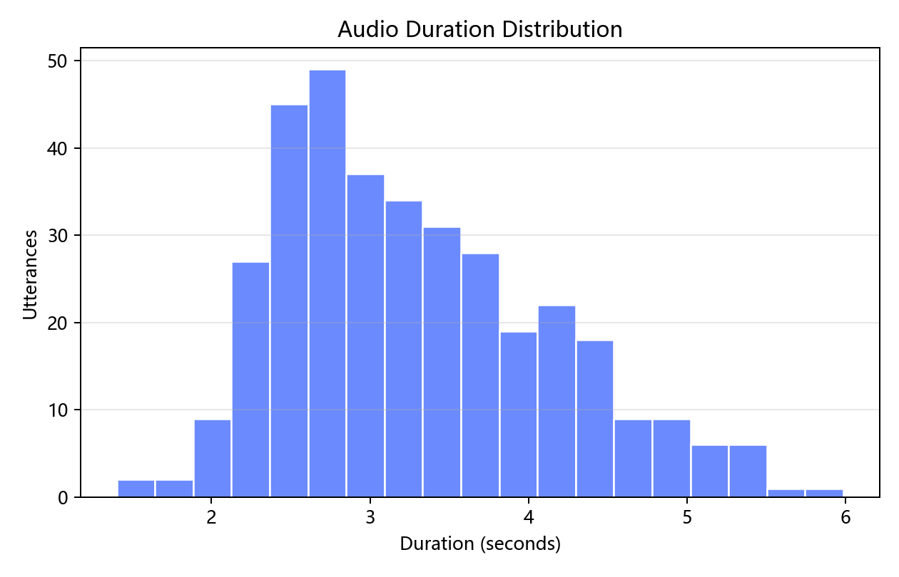
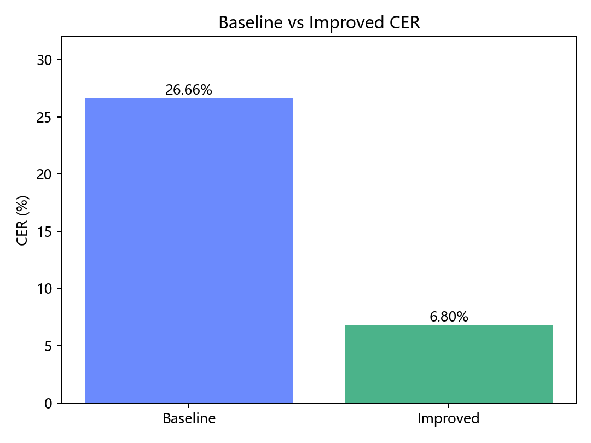
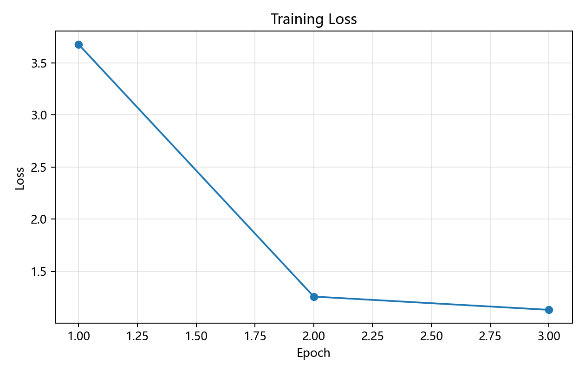
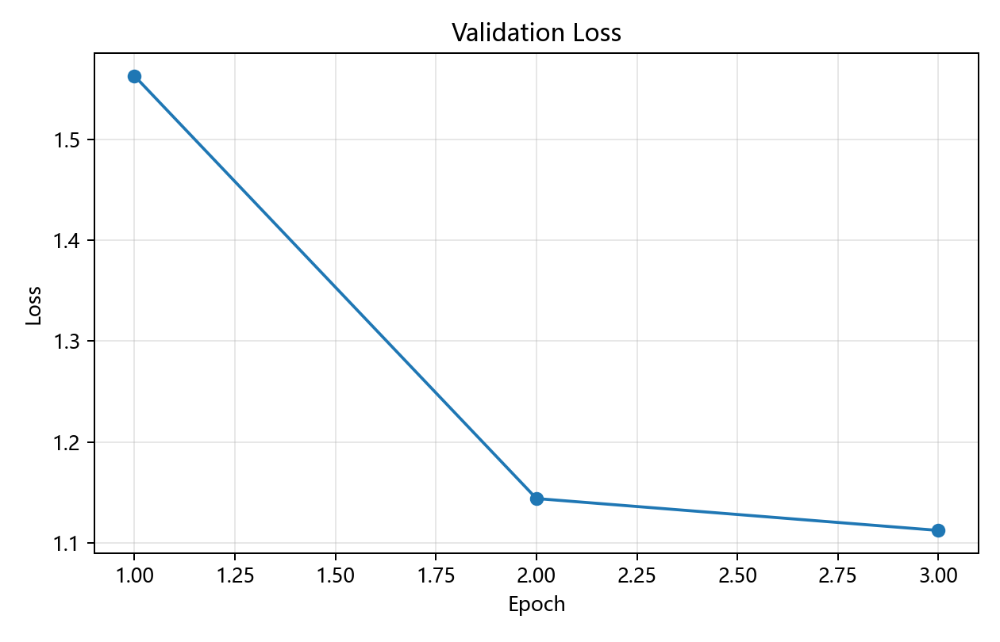
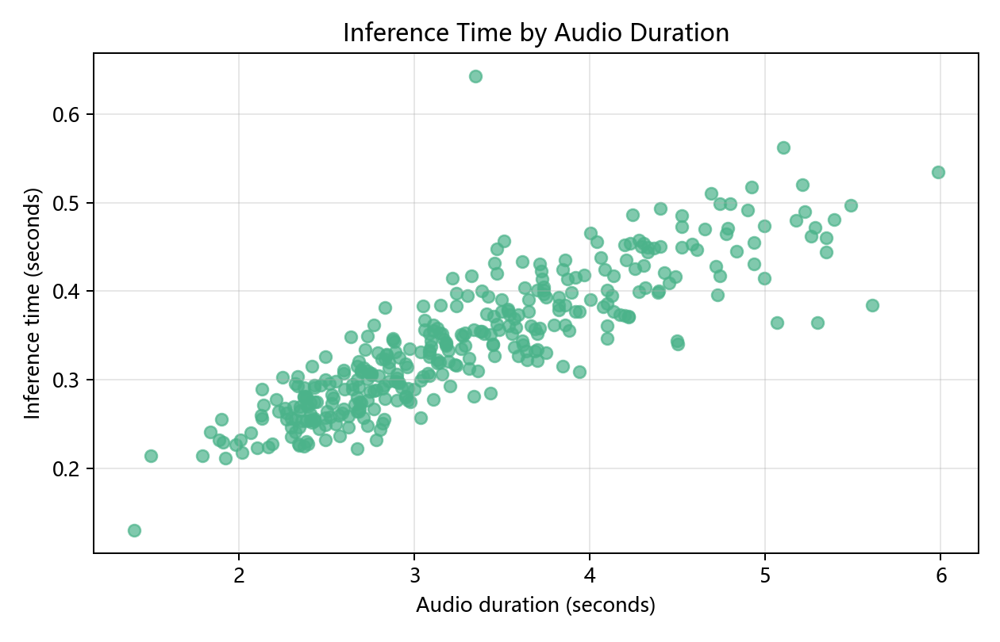
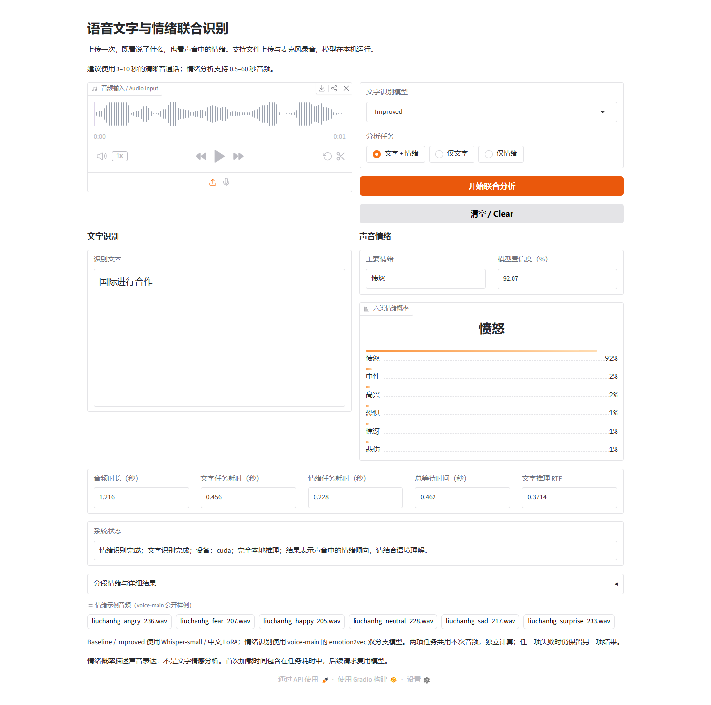

# 汉语连续语音识别实验

<p align="right">庞博文　2023K8009970013</p>

> 实验状态：主要实验已完成。本文数值均来自 `results/` 和 `checkpoints/` 中的实际运行文件。

## 1 实验目的

本实验构建一个端到端普通话连续语音识别系统，完成公开数据准备、预训练模型本地推理、参数高效微调、字符错误率评价、错误分析和可视化。系统在模型下载完成后可在本机离线推理。

## 2 方法原理

系统流程为：Audio → 16 kHz 单声道 → log-Mel Spectrogram → Transformer Encoder → Transformer Decoder → Chinese Transcript。

Whisper feature extractor 将波形转换为 80 维 log-Mel 频谱。Encoder 通过多层自注意力编码长程声学上下文；Decoder 使用 masked self-attention 建模已生成 token，并通过 cross-attention 读取 Encoder 隐状态，随后自回归生成中文转写。推理固定语言为中文、任务为 transcribe。

## 3 数据集

- 数据来源：Apache-2.0 的 AISHELL-1 普通话语料子集。
- 划分：S0002/S0003/S0004 三个不同说话人分别作为 train/dev/test，避免说话人泄漏。
- 存储：音频保留原路径，JSONL manifest 保存 `audio/text/split/duration/sample_rate`。
- 文本：NFKC 全半角统一、英文小写、移除标点/符号/无意义空格；数字保留。

实际扫描得到 1,073 条匹配语句，总时长 4,768.67 秒（1.3246 小时），平均 4.444 秒，最短 1.344 秒，最长 10.446 秒，全部为 16 kHz，共 15,069 个中文字符；另有 3 个音频没有匹配 transcript，未进入任何 manifest。

| 数据划分 | 说话人 | 语句数 | 用途 |
|---|---|---:|---|
| train | S0002 | 364 | LoRA 微调 |
| dev | S0003 | 354 | 验证损失与 checkpoint 选择 |
| test | S0004 | 355 | 最终 CER 评测，不参与训练 |



*图 1　测试集 355 条语音的时长分布，由 test manifest 中的时长字段绘制。*

## 4 实验环境

Windows 11；Intel Core i9-13900HX；NVIDIA GeForce RTX 4060 Laptop GPU 8 GB；NVIDIA driver 560.94；PyTorch 2.5.1 CUDA 12.1；cuDNN 9.1；Python 3.10。完整检查记录见 `docs/environment.md`。

## 5 Baseline

Baseline 为本地 `openai/whisper-small` 预训练模型，不在课程数据上更新参数。解码固定中文转写任务，使用 greedy decode；它提供明确且可复现的零样本参照。

## 6 改进方法

主改进使用 LoRA 参数高效微调。LoRA 只训练 attention 的 q/v projection 低秩矩阵，共 1,769,472 个参数，占 243,504,384 个总参数的 0.7267%，显著降低显存和 checkpoint 体积。

消融版本在相同 LoRA 配置下组合 speed perturbation、random gain、指定 SNR 的高斯背景噪声和 SpecAugment，验证增强对语速、响度和噪声鲁棒性的影响。实验发现增强版 CER 高于无增强版，因此最终 Improved 选用无增强 LoRA；增强结果作为负消融保留。

附加候选为受领域词典限制的拼音同音纠错，只允许等长、基础拼音完全一致的替换。是否启用必须由完整 test CER 决定，不能只展示有利案例。

## 7 实验设置

默认设置：seed 42；batch size 1；gradient accumulation 8；epoch 3；AdamW；learning rate 1e-4；warmup ratio 0.1；fp16；LoRA rank 16、alpha 32、dropout 0.05。梯度检查点在 smoke test 中对 Whisper 音频输入产生无梯度警告，正式运行关闭该选项。最终实际参数以 `checkpoints/improved/run_metadata.json` 为准。

## 8 实验结果

评价指标为字符错误率：`CER = (S + D + I) / N`，其中 S、D、I 分别为替换、删除和插入的字符数，N 为规范化后参考文本的字符数。训练与评测使用相同的文本规范化规则；本次 test set 的 N 为 5,041。相对 CER 降低率为 `(CER_baseline − CER_improved) / CER_baseline × 100%`。

| Method | CER | S | D | I | Relative CER Reduction |
|---|---:|---:|---:|---:|---:|
| Pretrained Whisper-small baseline | 26.66% | 1,257 | 73 | 14 | — |
| LoRA + augmentation ablation | 8.19% | 371 | 41 | 1 | 69.27% |
| **LoRA improved（selected）** | **6.80%** | **325** | **17** | **1** | **74.48%** |



*图 2　同一测试集上的 Baseline 与最终 LoRA 模型 CER。*

Baseline 平均单条推理时间 0.340 秒、平均 RTF 0.105；Improved 分别为 0.451 秒和 0.138。LoRA 使推理稍慢，但两者 RTF 都远小于 1，满足实时展示要求。训练三轮耗时 245.75 秒，train loss 为 3.678、1.256、1.129，validation loss 为 1.563、1.144、1.112。



*图 3　最终选用的无增强 LoRA 模型在三个 epoch 上的训练损失。*



*图 4　同一训练过程的验证损失；第三轮为本次记录的最低值。*



*图 5　Baseline 在 355 条测试语音上的推理耗时与音频时长关系。*

## 9 结果分析

LoRA 微调后错误数由 1,344 降至 343，绝对 CER 下降 19.86 个百分点。训练与测试语音来自同一语料、具有相同采样率，这可能有利于小样本域适配；该解释仍需在其他说话人或独立语料上验证，不能直接推广为通用中文识别性能。

增强版本虽然也明显优于预训练 baseline，却比无增强版本差 1.39 个 CER 百分点。该子集本身是安静室内高保真语音，且训练规模很小；较高概率的速度、增益、噪声和 SpecAugment 叠加后造成过强扰动。未来应在 dev set 上分别调低增强概率并做单因素消融，而不是假设增强必然有效。

固定 11 词的拼音领域词典在 355 条通用语句上触发 0 次，CER 不变。这证明该模块不会为了展示个例而被误称为整体提升。

## 10 错误分析

`scripts/error_analysis.py` 按单条 CER 排序并保存 20 个真实 case。典型结果如下：

| Reference | Prediction | Error type | CER |
|---|---|---|---:|
| 却永久提升了百分之十五 | 却永久提升了15 | 数字识别错误/漏字 | 45.45% |
| 肇事面包车驾驶员驶离现场 | 赵市面贸车驾驶员使力现场 | 替换错误 | 41.67% |
| 热血酷劲令人血脉喷张 | 热血枯尽令人血脉膨胀 | 替换错误 | 40.00% |
| 京津冀协同发展的需要 | 经经济协通发展的需要 | 同音近音替换 | 40.00% |
| 定期参加体育活动的人口占到了百分之九十四点一 | 定期参加体育活动的人口占到了941 | 数字格式/漏字 | 36.36% |

这些高 CER 样本主要体现同音近音替换、数字书写形式不一致和低频表达错误。该表只展示按单条 CER 排序的五个典型例子，不代表全体测试语句的错误类型比例。

## 11 文字与情绪联合识别原型

### 11.1 系统结构与界面

在原有中文语音识别项目基础上，系统整合了 `https://github.com/willinger566/voice-main` 的声音情绪识别模型（固定 commit `538403fb1940895f443904c303a0b448bbf6ab93`）。统一网页使用 Gradio 构建，入口为 `app.py`。同一次上传或录音交给两个独立模型：Whisper-small / 中文 LoRA 输出转写文本，emotion2vec+ large 双分支概率融合输出中性、高兴、悲伤、愤怒、恐惧、惊讶六类声音情绪及分段结果。情绪分析依据音频表征和声学特征，不依据转写文字进行情感推断。

`build_app()` 定义网页组件，`analyze()` 接收音频、文字模型和任务模式，通过两个工作线程并行调用 `WhisperASR.transcribe()` 与 `SpeechEmotionRecognizer.predict()`。先完成的任务先显示；单项失败不会清除另一项成功结果。文字模型与情绪模型分别缓存，后续请求复用。Gradio 使用同一并发组串行接收分析请求，避免不同用户请求同时更改情绪模型的中间层 hook。旧 `/recognize` 文字接口继续保留。

页面左侧显示识别文本，右侧显示主要情绪、模型置信度及六类概率。下方显示音频时长、两项任务耗时、总等待时间、文字推理 RTF 和状态提示，并可展开分段情绪和联合 JSON。首次任务耗时包含加载时间；原实验 CER/RTF 表格仍对应原有 ASR 评测，并非新增情绪模型准确率。

### 11.2 安装与启动

新电脑在完整工程根目录（包含 app.py 的目录）执行：

```powershell
cd C:\path\to\ChineseASR
conda env create -f environment.yml
conda activate chinese-asr
python scripts\download_model.py
python scripts\download_emotion_model.py
python app.py --inbrowser
```

情绪骨干约 1.81 GiB，正式分类及微调权重约 0.20 GiB。情绪下载脚本固定上游 commit，并校验生产权重的 Git LFS SHA256 和骨干 SHA256。下载完成后无需远程识别 API；模型在本机运行。已有旧环境时跳过环境创建，先补齐匹配的 torchaudio 与情绪依赖：

```powershell
conda activate chinese-asr
conda install -n chinese-asr -c pytorch -c nvidia torchaudio=2.5.1 pytorch=2.5.1 pytorch-cuda=12.1
python -m pip install -r requirements.txt
python scripts\download_emotion_model.py
```

本机环境与模型已准备后，只需激活环境并运行 `python app.py --inbrowser`。浏览器没有自动打开时，手动访问 `http://127.0.0.1:7860`。终端显示 `Running on local URL` 表示服务已启动；使用期间保留终端，结束时按 `Ctrl+C`。端口被占用时，可运行 `python app.py --port 7861 --inbrowser`，改为访问 `http://127.0.0.1:7861`。服务默认仅监听 localhost，`share=False`。

### 11.3 提交包复现

解压课程提交包后，先进入 `source_code/`，再执行上一节的环境创建、模型下载和启动命令。提交包的 `model/improved_adapter/` 保存最终中文 LoRA，`model/emotion_production/` 保存情绪正式权重；统一程序会自动查找相邻目录中的权重。两套大型预训练骨干没有重复放入提交包，首次运行需分别执行两个下载脚本。

### 11.4 网页操作

1. 上传音频，或允许浏览器麦克风权限并录音。上传后点击按钮；停止录音会自动分析。
2. 任务模式选择“文字 + 情绪”，文字模型可选择 Baseline 或 Improved，默认 Improved。
3. 点击“开始联合分析”，查看中文转写、主要情绪、模型置信度和六类概率。
4. 展开“分段情绪与详细结果”，查看每段时间范围与原始 JSON。
5. 需要单独使用时选择“仅文字”或“仅情绪”；“清空”会移除音频和结果并保留当前模型与任务选择。

中文转写主要针对普通话。情绪模型保留原项目的 0.5–60 秒输入限制，建议使用 3–10 秒单人清晰语音，减少静音和背景音乐。过短、静音或超过上限时会显示原因；若文字识别已完成，文字结果仍保留。模型概率并不等同于正确率；低置信度时保留原情绪模型的不明确提示。原项目出处和数据许可保留在 `third_party/voice-main/`，不能用 ASR 的 CER 改善代表情绪任务也有同样改善。

详细运行步骤见 `docs/joint_ui.md`，接口验收脚本为 `scripts/verify_joint_ui.py`，真实上传与按钮流程的浏览器验收脚本为 `scripts/browser_joint_smoke.py`（另需安装 Playwright，使用本机 Edge）。

### 11.5 联合功能验收

联合逻辑及原项目共 20 项单元测试通过。通过真实 Gradio 上传接口分别输入愤怒、高兴、悲伤三个上游公开样例，均获得非空中文转写、六类概率及分段情绪，主要情绪分别为愤怒（92.07%）、高兴（92.14%）、悲伤（74.43%）。这里的百分比是单条模型概率，不是三类或全体音频的准确率。首次联合请求因模型加载耗时约 34.17 秒，随后两条复用模型分别约 0.52 秒和 0.27 秒；该时间仅是本次机器上的功能验收记录，不能代替系统性性能评测。

权重下载均按原始 SHA256 校验。上游保存的模型签名包含 JSON 文件原始字节，恢复 Windows CRLF 换行后与其参考签名完全一致；三个样例的最大概率差约 0.000061，可能与 PyTorch 版本和硬件数值差异有关。另以本机 Edge 实际上传音频并点击“开始联合分析”，页面同时显示文字和愤怒结果，前端无运行错误。原 Baseline/Improved 文字接口及两个单独模式也已验证。首次加载证据保存在 `results/joint_ui_cold_start_verification.json`，后续含签名核对的复测为 `results/joint_ui_verification.json`，浏览器证据为 `results/joint_browser_verification.json`。项目与提交包分别运行 20 项测试均通过，最终自动验收为 24 PASS、0 FAIL。



*图 6　同一段输入音频同时输出中文转写、声音情绪、完整六类概率和性能指标。*

## 12 总结

本实验完成了本地 Whisper-small 连续中文识别、说话人隔离的数据划分、统一规范化、自实现 CER、LoRA 微调、增强和拼音纠错消融、错误分析与可视化。最终 LoRA 模型在 355 条测试语句上将 CER 从 26.66% 降至 6.80%，相对下降 74.48%，平均 RTF 为 0.138。局限是训练数据仅一个说话人、总规模较小；未来应扩大说话人数、采用独立语料评测泛化能力，并在噪声测试集上重新调优增强强度。

