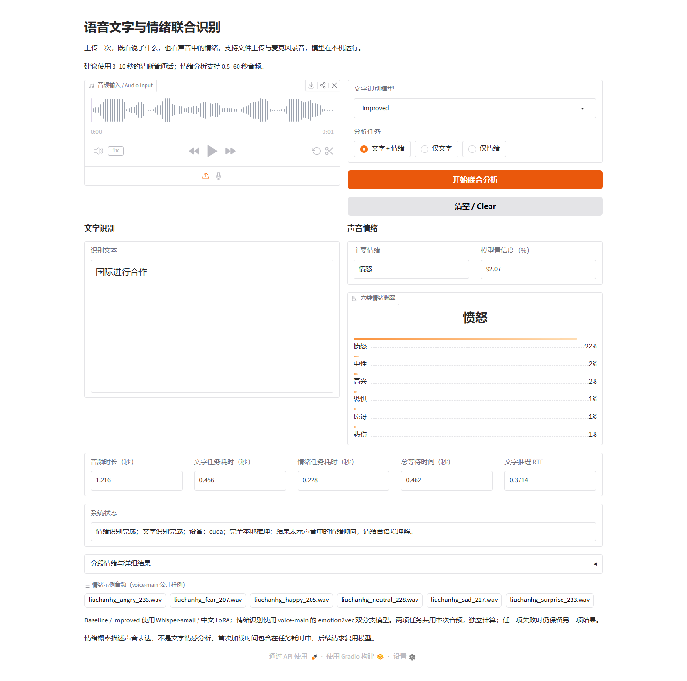

# 语音文字与情绪联合识别

同一段音频，同时显示中文转写和声音情绪。支持上传音频、麦克风录音、Baseline / Improved 切换、六类情绪概率以及分段结果。



## 下载后打开 UI

推荐 Windows 10/11、16 GB 以上内存；本项目在 RTX 4060 Laptop 8 GB 上验证。首次安装环境和模型需要联网，并预留约 15 GB 空间。无需训练数据集，也无需重新训练。

1. 安装 Anaconda 或 Miniconda。如果本机已有 `chinese-asr` 环境，可直接复用。
2. 点击本仓库 **Code → Download ZIP**，解压整个文件夹；也可用 Git 克隆。不需要 Git LFS。
3. 双击根目录的 **启动联合界面.cmd**。
4. 启动程序会在需要时创建环境，从本仓库 Release 下载约 2.90 GiB 模型并校验 SHA256，然后打开网页。
5. 浏览器访问 **http://127.0.0.1:7860**。上传或录制普通话，选择“文字 + 情绪”，点击“开始联合分析”。

首次加载需等待几十秒。服务运行时保留终端；结束时按 Ctrl+C。下载中断后重新运行启动程序即可续传。模型已下载后不需要每次重新下载。

如果端口已占用，在 PowerShell 中运行：

```powershell
powershell -NoProfile -ExecutionPolicy Bypass -File .\Start-UI.ps1 -Port 7861
```

### 手动启动

在仓库根目录执行：

```powershell
conda env create -f ChineseASR/environment.yml
conda activate chinese-asr
python ChineseASR/scripts/bootstrap_models.py
cd ChineseASR
python app.py --inbrowser
```

`environment.yml` 配置的是 PyTorch 2.5.1 / CUDA 12.1 和配套 torchaudio。CPU 电脑可先在独立 Python 3.10 环境安装配套 CPU 构建，再安装本项目依赖；运行会比 GPU 慢：

```powershell
python -m pip install torch==2.5.1 torchaudio==2.5.1 --index-url https://download.pytorch.org/whl/cpu
python -m pip install -r ChineseASR/requirements.txt
python ChineseASR/scripts/bootstrap_models.py
cd ChineseASR
python app.py --inbrowser
```

## 两项功能分别是什么

| 功能 | 模型 | 输出 |
|---|---|---|
| 语音转文字 | Whisper-small；Improved 加载中文 LoRA | 中文转写、耗时、文字推理 RTF |
| 声音情绪 | voice-main 的 emotion2vec+ large 双分支融合 | 中性、高兴、悲伤、愤怒、恐惧、惊讶概率及分段结果 |

情绪模型处理声音表达，不是对转写文字做情感分析。建议使用 3–10 秒单人清晰普通话；情绪分析支持 0.5–60 秒。界面的模型概率不等于准确率。

## 项目结构

- `ChineseASR/`：整合后的可运行工程，优先使用这个目录。
- `交接报告/`：第三方交接报告的 Word、PDF、Markdown 版，以及原始任务说明。
- `工作记录/voice-main/`：原情绪项目的源码与实验记录归档。
- `工作记录/`：开发脚本、报告校样及其他项目档案。
- `迁移记录/`：原本机迁移的哈希清单和环境快照。
- `项目历史/`：两个项目的 Git 历史 bundle；避免把嵌套 `.git` 当成子模块上传。
- `model-assets.json`：大型模型的 Release 文件名、恢复路径、大小和 SHA256。
- `demo.mp4`：演示视频。

### 大型模型在哪里

GitHub 普通 Git 不接收超过 100 MiB 的单文件。三份大型权重保存在本仓库 `models-v1` Release，启动程序会自动恢复到约定位置：

- Whisper-small 主权重。
- emotion2vec+ large 骨干。
- 情绪模型的微调骨干参数；重复使用位置由同一份下载恢复。

配置、tokenizer、scaler、分类头、最终中文 LoRA、示例音频和源码保存在仓库中。GitHub 的源代码 ZIP 不包含上述大型权重本体，因此请使用根目录启动程序，或先运行 `bootstrap_models.py`。

## 实验结果与验证范围

原中文实验使用 AISHELL-1 子集：train/dev/test 为 364/354/355 条。355 条测试语句上的 CER 从 26.66% 降为 6.80%，相对错误率下降 74.48%。数据增强版本为 8.19%，按真实结果保留为消融。情绪模型的历史评估来自原项目；本次联合功能没有宣称新的情绪准确率。

项目与提交包分别通过 20 项单元测试，整合及迁移版本通过 24 项验收，并实测浏览器上传后同时显示文字和情绪。详细证据和限制见交接报告、`ChineseASR/results/` 和原实验报告。

```powershell
cd ChineseASR
python -m pytest tests -q
# 保持 UI 运行，再在另一终端运行
python scripts/verify_joint_ui.py
```

## 上传版与本机完整档案的区别

本上传版不包含 AISHELL 训练数据集、浏览器配置与 Cookie、临时录音缓存、Python 缓存和测试临时目录。这些不是打开 UI 所需文件。报告中的本机 D 盘路径和迁移清单是历史记录；其他电脑请以仓库根目录启动方式为准。

课程训练和完整数据评测需要先运行数据下载与准备脚本；`verify_project.py` 中依赖原始数据的研究验收不适用于未下载数据的精简运行版。恢复数据的方法见 `ChineseASR/README.md`，日常 UI 无需执行。

归档的上游 `.gitattributes` 保存为 `.gitattributes.upstream`，防止原 LFS 规则影响本仓库的普通下载。原情绪项目归档不是单独配置好的部署环境；实际完整模型由整合工程和本仓库 Release 提供。

## 来源和许可

- [Whisper-small](https://huggingface.co/openai/whisper-small)
- [AISHELL-1](https://huggingface.co/datasets/AISHELL/AISHELL-1)
- [voice-main](https://github.com/willinger566/voice-main)，固定 commit `538403fb1940895f443904c303a0b448bbf6ab93`
- [emotion2vec+ large](https://modelscope.cn/models/iic/emotion2vec_plus_large)

上游来源、原数据许可及改动说明保存在 `ChineseASR/third_party/voice-main/`。组合情绪权重、语料和 openSMILE 保留原有研究、教育或非商业约束；本仓库没有为第三方材料重新赋予统一商业许可。
