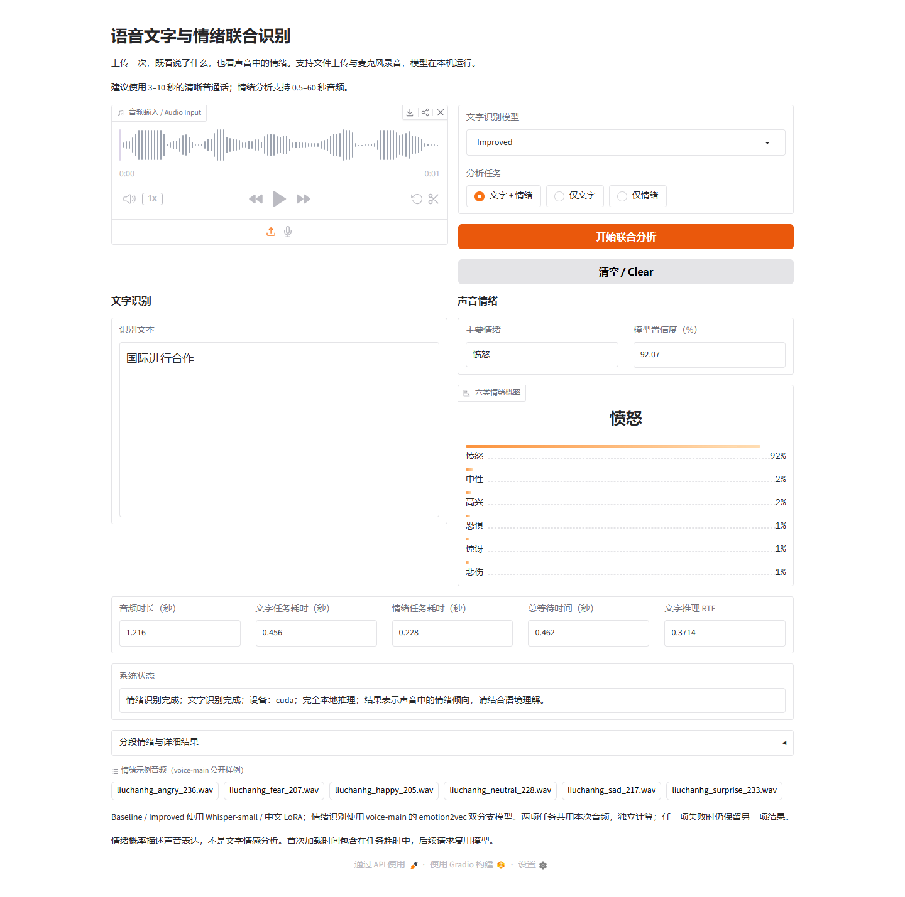

版本日期  2026年11月24日

# 语音文字与情绪联合识别项目总结与交接报告

版本日期 2026年11月24日

## 1 项目是什么

本项目是一个运行在本机的中文语音分析系统。使用者上传一段录音或通过麦克风录音后，可以在同一个网页看到说话内容的中文文字，以及声音表达出的情绪倾向。文字识别与情绪识别由两套模型独立完成，一次点击即可并行运行，也可以只使用其中一项。

交接后的完整工程位于 D:\语音大作业\ChineseASR。模型、原始数据、训练结果、Git 历史和课程提交包均保留。当前电脑已经具备运行环境和模型，接手者无需重新训练即可演示系统。

| 需要了解的事项 | 当前状态 |
| --- | --- |
| 网页入口 | http://127.0.0.1:7860，仅本机访问 |
| 文字模型 | Whisper-small；可切换 Baseline 与中文 LoRA Improved |
| 情绪模型 | voice-main 的 emotion2vec+ large 双分支模型 |
| 识别范围 | 普通话中文转写；中性、高兴、悲伤、愤怒、恐惧、惊讶六类声音情绪 |
| 主要实验结果 | 355 条测试语音上 CER 从 26.66% 降至 6.80% |
| 功能验收 | 20 项单元测试通过，24 项自动验收通过 |

阅读建议：需要演示时先读第2节；需要理解实现时读第3至5节；需要换电脑或继续开发时读第6节；文件保留和迁移信息见第7至8节。

本报告区分三个概念：文字识别的 CER 是字符错误率；情绪界面上的百分比是当前录音的模型概率；少量样例的功能验收不能当作情绪准确率实验。

## 2 如何打开和使用系统

在 D:\语音大作业 中双击“启动联合界面.cmd”。终端显示 Running on local URL 后，浏览器打开 http://127.0.0.1:7860。首次加载模型可能需要几十秒，后续请求会复用已加载模型。使用期间保留终端，结束时按 Ctrl+C。



图1  实际上传同一段音频后，网页同时显示中文转写和六类声音情绪概率。

操作顺序：上传音频或录音，选择“文字 + 情绪”，保留 Improved 或切换 Baseline，然后点击“开始联合分析”。停止麦克风录音会自动分析。展开“分段情绪与详细结果”可查看时间段与原始 JSON。

建议使用3至10秒单人普通话，减少音乐和长静音。情绪模型接受0.5至60秒语音；超出限制会给出提示。选择“仅文字”或“仅情绪”可单独使用功能。“清空”移除音频和结果，保留当前选择。

## 3 系统如何实现

Gradio 根据 app.py 中的 Python 组件生成网页。音频输入以文件路径交给 analyze()，两个工作线程分别运行文字和情绪任务。先完成的结果先显示；任一任务失败时，另一任务的成功结果仍会保留。不同分析请求共用同一个并发组，避免多次推理相互干扰。

| 环节 | 文字识别分支 | 声音情绪分支 |
| --- | --- | --- |
| 共同输入 | 同一次上传或录音的音频文件 | 同一个音频文件，不使用转写文本 |
| 预处理 | 解码、转单声道、重采样到16 kHz | 质量检查、16 kHz、分段、幅值归一化和边界静音裁剪 |
| 模型计算 | Whisper-small；Improved 附加本地 LoRA | 两个独立 emotion2vec 骨干和声学特征融合分类器 |
| 结果 | 文字、音频时长、推理耗时、RTF | 六类概率、主要情绪、分段、质量提示 |

### 3 1 文字模型的关系

Baseline 是直接使用的预训练 Whisper-small。Improved 使用同一个基础模型，并加载本项目训练得到的 LoRA adapter。LoRA 只训练少量新增参数，避免为小规模课程数据重新训练整套模型。最终采用的是无数据增强的 LoRA 版本，因为实际测试优于增强版本。

### 3 2 情绪模型的关系

情绪功能来自 willinger566/voice-main，固定版本为 538403fb1940895f443904c303a0b448bbf6ab93。系统保留其音频预处理、特征、分类器、温度校准和概率融合。整合时主要改为包内相对导入，并增加兼容 Python 3.10 的流式 SHA256 校验。

每个情绪分支包含4,287维特征，包括语音表征均值和标准差、103项声学统计、88项 eGeMAPS 特征及中间层统计。冻结分支与末端四层微调分支各占50%。长录音按时间分段，整体概率按有效音频时长汇总。

模型下载后从本地文件加载，不调用远程语音识别接口。下载脚本需要联网；网页默认 share=False，只监听 localhost。浏览器麦克风权限由使用者决定。

## 4 中文语音识别实验

实验使用 AISHELL-1 的三个说话人子集，共 1,073 条有效语句、约 1.325 小时，全部为16 kHz。S0002、S0003、S0004分别用于训练、验证和测试，三部分说话人互斥。未匹配到文本的3条音频未纳入清单。

| 划分 | 说话人 | 语句数 | 用途 |
| --- | --- | --- | --- |
| train | S0002 | 364 | 拟合 LoRA 参数 |
| dev | S0003 | 354 | 选择最优 checkpoint |
| test | S0004 | 355 | 最终统一评测 |

训练使用3轮、batch size 1、梯度累积8、学习率0.0001、fp16、随机种子42；LoRA rank为16，alpha为32，dropout为0.05。正式训练关闭梯度检查点。原始配置和训练历史保存在 checkpoints 中。

| 方法 | CER | 替换 删除 插入 | 相对错误率下降 |
| --- | --- | --- | --- |
| 预训练 Baseline | 26.66% | 1257 / 73 / 14 | — |
| LoRA 加增强 | 8.19% | 371 / 41 / 1 | 69.27% |
| 最终 Improved | 6.80% | 325 / 17 / 1 | 74.48% |

CER 的计算是替换、删除和插入字符数之和，除以参考文字的字符数；越低越好。本次355条测试语句共有5,041个规范化参考字符，错误数从1,344降到343。最终模型比 Baseline 下降19.86个百分点，相对下降74.48%。这不是“准确率提高74.48个百分点”。

最终模型平均单条推理耗时约0.451秒，平均 RTF 约0.138。RTF 是推理耗时与音频时长之比，小于1表示本次测量中处理速度快于音频播放速度。联合网页中的首次模型加载时间另行计入任务耗时。

增强版本的 CER 比最终版本高1.39个百分点，因此作为负消融保留。11词拼音纠错词典在测试集触发0次，未带来额外改善。训练数据仅一个说话人，不能据此承诺任意真实录音都有同样效果。

证据：results/baseline_results.json、improved_results.json、augmentation_results.json；对应逐条预测 CSV；checkpoints 中的 training_history 与 run_metadata；report/experiment_report.md。

## 5 情绪识别和联合功能验证

情绪分类器使用另一个项目已经训练好的正式模型，本次整合没有重训情绪模型，也没有把转写文字交给文本情感分析器。所有分类及微调权重按原始 Git LFS SHA256 校验，约1.81 GiB骨干按训练配置要求的 SHA256 校验。

原情绪项目含独立录音库的评估记录，保存在工作记录中的 voice-main/results。它们是上游结果，不是本次联合页面的新测试成绩；该部署仓库也不包含重新训练全部历史候选的完整训练工程。

| 公开样例 | 返回的主要情绪 | 单条模型概率 | 联合结果 |
| --- | --- | --- | --- |
| angry_236 | 愤怒 | 92.07% | 文字与情绪均返回 |
| happy_205 | 高兴 | 92.14% | 文字与情绪均返回 |
| sad_217 | 悲伤 | 74.43% | 文字与情绪均返回 |

这三个样例验证的是功能链路和输出结构。概率表示模型对这条输入的分配，不代表识别正确的保证，也不能用三个样例估计一般场景的准确率。短语、口音、噪声、语境和混合情绪都可能影响结果。

| 检查 | 结果 |
| --- | --- |
| 项目与提交包单元测试 | 分别20项通过 |
| 自动项目验收 | 24项通过，0项失败 |
| 浏览器实际操作 | Edge 上传音频并点击联合分析，文字与情绪均显示，无前端运行错误 |
| 独立模式与兼容接口 | 仅文字、仅情绪，以及 Baseline/Improved 的原文字 API 均通过 |
| 模型一致性 | 恢复 Windows CRLF 后签名与上游参考一致；三个样例最大概率差约0.000061 |

首次联合请求约 34.17 秒，包含情绪模型加载；随后两条约0.52秒和0.27秒。这是本机功能验收的观察值，不代表所有长度、硬件或录音条件下的性能。

证据保存在 results/joint_ui_cold_start_verification.json、joint_ui_verification.json 和 joint_browser_verification.json。物理麦克风录音的音质未自动验证；页面录音控件和停止录音事件已经接入。

## 6 接手者如何安装与复现

### 6 1 当前电脑

本机环境原本就在 D 盘，路径是 D:\Anaconda\envs\chinese-asr，迁移时保留原位。当前使用 Python 3.10.21、PyTorch 2.5.1、CUDA 12.1、Gradio 6.17.3 和 RTX 4060 Laptop 8 GB。双击根目录启动文件即可运行；也可手动执行：

```powershell
cd D:\语音大作业\ChineseASR
conda activate chinese-asr
python app.py --inbrowser
```

### 6 2 另一台电脑

复制完整工程后创建环境，不要直接复制整个 Conda 环境目录。torch 与 torchaudio 必须配套；无 NVIDIA GPU 时需要选择相应 CPU 构建。完整工程已含模型；只有模型缺失或仅复制课程提交包时才需重新下载。

```powershell
conda env create -f environment.yml
conda activate chinese-asr
python scripts/download_model.py
python scripts/download_emotion_model.py
python app.py --inbrowser
```

### 6 3 重现文字实验

原始语音和相对路径 manifest 已保存。下列命令将重新训练到独立目录，不覆盖随工程交付的最终模型。情绪项目的历史训练不包含在这些命令中。

```powershell
python scripts/train.py `
  --train_manifest data/manifests/train.jsonl `
  --dev_manifest data/manifests/dev.jsonl `
  --config configs/improved.yaml `
  --output_dir checkpoints/reproduction --device cuda
```

先用 README 中的两条样本 smoke test 验证环境，再进行正式训练。已有实验可直接检查 CSV、JSON、曲线和 checkpoint；重新下载数据使用 scripts/download_dataset.py，再运行 scripts/prepare_data.py。

### 6 4 验证联合页面

```powershell
python -m pytest tests -q
python scripts/verify_joint_ui.py
python scripts/verify_project.py
```

后两个命令要求网页服务已启动。浏览器自动验收使用 scripts/browser_joint_smoke.py，另需 Playwright 和本机 Edge。环境精确清单保存在迁移记录目录。

## 7 文件位置和保留建议

```powershell
D:\语音大作业\
  ChineseASR\       完整工程及 Git 历史
  交接报告\         总结报告 Word PDF Markdown
  工作记录\         原工作文件和上游仓库
  迁移记录\         文件哈希 日志 环境快照
  启动联合界面.cmd    当前电脑的一键启动入口
```

| ChineseASR 内的目录 | 内容 | 保存建议 |
| --- | --- | --- |
| src / app.py / scripts | 两套模型的适配、统一界面、训练评估和下载脚本 | 长期保留 |
| models | Whisper 基础模型和情绪骨干、正式分类模型 | 本机离线运行必需 |
| checkpoints | 最终中文 LoRA、增强消融及训练记录 | 保留最终与消融证据 |
| data/raw 与 data/manifests | 真实音频、文本和相对路径清单 | 复现实验时保留 |
| results 与 report | 逐条预测、指标、曲线及原实验报告 | 课程证据和分析材料 |
| submission | 可提交材料，不重复包含两套大型骨干 | 提交时使用此目录 |
| third_party | 上游来源、固定版本、数据与模型许可说明 | 分享工程时一并保留 |

主工程与 submission 用途不同：主工程开箱运行并保留原始数据；submission 是精简交付目录，需要重新下载基础模型。不能仅保留 LoRA adapter 就删除 Whisper 基础模型，也不能把情绪正式权重与不匹配的骨干混用。

工作记录包含上游仓库、旧报告渲染、编解码测试和独立验收副本。它们不参与日常网页运行，但已经按本次要求归档，便于追溯开发过程。Git 历史随主工程保留；本次没有向远程仓库推送。

不要删除或改名 models/emotion/production 中的分支权重、scaler 和配置。openSMILE、上游语料和组合权重遵循各自原有许可，不能将整合后的课程工程默认视为可任意商用的软件。

## 8 迁移核验和后续维护

迁移先复制再逐文件校验，核对文件长度及 SHA256，确认目标与源文件一致后才清理 C 盘冗余副本。历史实验 JSON 中的原 C 盘路径作为当时运行证据保留；实际程序使用项目相对路径和新启动入口。

| 迁移对象 | 已校验文件 | 字节数 | 结果 |
| --- | --- | --- | --- |
| project | 1797 | 3,722,535,273 | SHA256一致 |
| work | 908 | 46,055,574 | SHA256一致 |

以上是复制时的源文件快照；交接报告、环境快照和迁移日志是随后新增的交付材料。原 C 盘位置只保留兼容目录链接。两处旧 .pytest_cache 因历史权限无法读取，属于可重建的测试缓存，已列入迁移日志；源码、模型、音频和实验结果均通过校验。

| 现象 | 处理方法 |
| --- | --- |
| 网页打不开 | 先运行启动文件；终端必须保持运行；检查是否已显示本地网址 |
| 7860端口占用 | python app.py --port 7861 --inbrowser，访问相应端口 |
| 文字或情绪模型缺失 | 按提示运行对应下载脚本；也可临时选择另一单独模式 |
| 录音静音或情绪失败 | 检查麦克风权限和音量，改用3至10秒清晰单人语音 |
| 换电脑依赖报错 | 按 environment.yml 重建环境，核对 torch 与 torchaudio 构建 |

后续工作建议优先扩大中文训练说话人数，另设独立真实录音评估集，再分别报告文字 CER 和情绪准确率或宏F1。保留当前模型及固定测试结果作为回归基线，新实验输出到新目录，避免覆盖已交付证据。

### 资料来源

Whisper-small：https://huggingface.co/openai/whisper-small
AISHELL-1：https://huggingface.co/datasets/AISHELL/AISHELL-1
情绪原项目：https://github.com/willinger566/voice-main
情绪骨干：ModelScope iic/emotion2vec_plus_large。
本次数据依据为主工程内实际保存的配置、训练记录、逐条预测、验收 JSON 及第三方来源文件。
